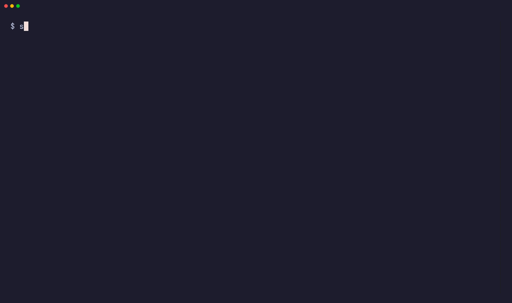

# onbehalf operator guide

This guide is for the operator. The operator installs and runs onbehalf on
a shared host. For a new installation, do the sections in sequence.


**Contents**

- [What onbehalf does](#what-onbehalf-does) · [Requirements](#requirements)
- [Set up a host](#set-up-a-host): [1. AI harness and a gateway](#step-1-install-the-ai-harness-and-run-a-model-gateway) ·
  [2. Stack source](#step-2-prepare-the-stack-source) ·
  [3. Install and set up](#step-3-install-onbehalf-and-run-the-setup)
- [What users do without root](#what-users-do-without-root)
- [Change the shared stack](#change-the-shared-stack) ·
  [Change the AI harness](#change-the-ai-harness) ·
  [MCP servers with a personal login](#mcp-servers-with-a-personal-login) ·
  [Work tools of the shared stack](#work-tools-of-the-shared-stack)
- [Add users](#add-users) · [Enroll users at their first login](#enroll-users-at-their-first-login) ·
  [Users from an Entra group](#users-from-an-entra-group) ·
  [Move from a shared account](#move-from-a-shared-account)
- [Operators](#operators) · [A runtime for an operator](#a-runtime-for-an-operator)
- [Check the host](#check-the-host) · [Check model access](#check-model-access) ·
  [See who uses the runtimes](#see-who-uses-the-runtimes) ·
  [Health checks and alerts](#health-checks-and-alerts) · [First real test](#first-real-test)
- [Offboard a user](#offboard-a-user) · [Update the AI harness](#update-the-ai-harness)
- [Known limitations](#known-limitations) · [Model access fails](#model-access-fails) ·
  [Troubleshooting](#troubleshooting)

## What onbehalf does

onbehalf lets a team use one AI harness setup on one shared Linux host. The
runtime of each user runs as that user, with the credentials of that
user.

- **Shared stack.** One read-only location for all users. It contains the
  harness settings, the harness instructions, custom agents, skills and the
  model catalog. The team owns the content. onbehalf gives it to each
  user.
- **Personal gateway key.** Each user has a personal key for the model
  gateway. The gateway records the model use of each user.
- **Personal identity.** Each user has a Linux account. The runtime runs
  as that account. The logins for Azure CLI, GitHub and Git stay in the
  home directory of the user.

onbehalf works at the Unix layer: accounts, file owners, permissions, links
and services. It does not install or operate the AI harness, the model
gateway or the work tools. It does not manage the logins to Azure, GitHub or
other tools. Each user logs in to each tool with the usual login of that
tool. `onbehalf tools` guides a user through those logins, without root.
It never keeps or reads a credential.

Use root only for the work that must have root. Each user makes all the
other changes in their own account. See
[What users do without root](#what-users-do-without-root). The full
table of owners is in the
[project scope](../project.md#scope-of-the-mvp-and-phase-1).

## Requirements

- Ubuntu (tested: 24.04) or Arch Linux.
- Root access on the host.
- One AI harness, installed for the full host: OpenCode 2.x, Claude Code
  2.1 or Codex 0.162. All users use this one installation.
- A model gateway that runs: LiteLLM with PostgreSQL. It can be on the same
  host or on a different host. It must serve the API of the AI harness.

## Set up a host

Do these three steps:

1. Install the AI harness and run a model gateway.
2. Prepare the stack source.
3. Install onbehalf and run `sudo onbehalf setup`.

### Step 1: Install the AI harness and run a model gateway

onbehalf does not install these applications. Use the documentation of
each application.

#### AI harness

Select one AI harness for the host. Every user uses it. A host never has
more than one AI harness.

| AI harness | Name for onbehalf | Command | API that the gateway must serve |
|---|---|---|---|
| OpenCode | `opencode` | `opencode` | `/v1/chat/completions` |
| Claude Code | `claude` | `claude` | `/v1/messages` and `/v1/messages/count_tokens` |
| Codex | `codex` | `codex` | `/v1/responses` |

Install the AI harness for the full host with its documentation. For
example, install OpenCode with npm:

```
sudo npm install -g --allow-scripts=@opencode/cli @opencode/cli@<version>
```

Use one version for all users. Do not use a personal installation in a
home directory for the shared setup.

You can change the AI harness of a host at a later time. See
[Change the AI harness](#change-the-ai-harness).

#### Model gateway

An operator owns the model gateway: LiteLLM, the database, the model
provider keys and the model deployments. Use the LiteLLM documentation. The
gateway can run on its own host or in Docker.

onbehalf uses only these items from the gateway:

- A URL that the shared host can connect to.
- The admin key of the gateway (`LITELLM_MASTER_KEY`). onbehalf uses it to
  make and revoke the personal keys.
- A `model_name` for each model that the team uses.

**Two different endpoints.** The gateway URL is the address of LiteLLM, for
example `http://127.0.0.1:4000`. The endpoint of the model provider goes
into the LiteLLM configuration as `api_base`. An example is
`https://<resource>.openai.azure.com` from the Azure AI Foundry portal. Do
not give this endpoint to onbehalf. `onbehalf init` refuses Azure AI Foundry
URLs and other provider URLs.

**Two types of credentials.** The model provider keys stay in the gateway.
onbehalf never asks for them. onbehalf asks only for the admin key of the
gateway. Each user gets a personal gateway key from onbehalf.

`examples/gateway` is only an example. It shows a LiteLLM deployment with
Docker Compose and Azure AI Foundry models. You can use it for a test or a
small team. After the installation, the examples are in
`/usr/local/share/onbehalf/examples`. To use the example:

1. Copy `examples/gateway` to `/etc/onbehalf-gateway` on the gateway host.
2. Copy `.env.example` to `.env`.
3. Set the mode of `.env` to 600: `chmod 600 /etc/onbehalf-gateway/.env`.
4. In `.env`, set `LITELLM_MASTER_KEY`, `POSTGRES_PASSWORD` and the
   provider keys.
5. In `litellm.yaml`, replace each `<...>` value with the value from the
   Azure AI Foundry portal.
6. Start the gateway as root: `docker compose up -d`.
7. Make sure that the gateway answers:
   `curl http://127.0.0.1:4000/health/liveliness`.

> **WARNING:** Do not add users to the `docker` group. A member of that
> group can get root access. `onbehalf doctor` shows this as an error.

The example publishes the gateway on `127.0.0.1` only. If the gateway is on
a different host, publish it on an internal address. The shared host must
connect to that address.

### Step 2: Prepare the stack source

The stack source is a directory with the configuration of the AI harness.
The team owns it. Keep it in a Git repository of your team. Review each
change. Start from `examples/stack`:

```
models.json       the model catalog and an optional default model
AGENTS.md         harness instructions for every runtime
skills/           shared skills
opencode/         settings, custom agents and commands of OpenCode
claude/           settings, custom agents and commands of Claude Code
codex/            settings of Codex
tools/            optional: work tools of the team
```

The items at the root are for each AI harness. Thus the team keeps its
stack source when the host changes to a different AI harness. The
directory of an AI harness is optional.

The team decides the content. onbehalf writes these items into the
configuration of the AI harness. Do not set them in the stack source:

| File | Do not set |
|---|---|
| `opencode/opencode.json` | `providers`, `enabled_providers`, `model` |
| `claude/managed-settings.json` | `model`, `apiKeyHelper`, `availableModels`, `env.ANTHROPIC_*`, `env.CLAUDE_CODE_USE_*` |
| `codex/config.toml` | `model`, `model_provider`, the provider `onbehalf` |

Put `AGENTS.md` and each skill in one location only: at the root, or in
the directory of one AI harness. Do not put the file `opencode.jsonc` in
the stack source. It is for personal overrides.

Each model is in two locations:

1. An operator deploys the model on the gateway first.
2. Then the team adds the model name to the model catalog in
   `models.json`:

   ```json
   {
     "model": "gpt-5.4",
     "models": {
       "gpt-5.4": { "api": "openai" },
       "claude-sonnet-4-5": { "api": "anthropic" }
     }
   }
   ```

   Each name in `models` must be a `model_name` of the gateway.

`onbehalf stack install` makes sure that the gateway has each model of the
model catalog. If a model is not on the gateway, the installation stops and
changes nothing. A default `model` is optional. Without it, the first model
is the default model. `api` is optional, and only OpenCode uses it. See
`examples/stack/README.md`.

#### A stack source of version 0.1.0

A stack source without `models.json` keeps its function, but only for
OpenCode. Then the enabled `providers.*.models` entries of
`opencode/opencode.json` are the model catalog, and these rules apply:

- Each provider must use `@GATEWAY_URL@/v1` as `baseURL`.
  `onbehalf stack install` writes the real address in its place.
- Each provider must use the personal key reference
  `{file:~/.config/onbehalf/gateway.key}` as `apiKey`.
- `enabled_providers` must list the providers of the stack source, and no
  other providers.
- The `modelID` of each model must be a `model_name` of the gateway. If a
  model has no `modelID`, its entry name must be a `model_name`.

> **CAUTION:** Always set `enabled_providers` in such a stack source.
> Without it, OpenCode adds its built-in providers, for example its free
> `opencode/*` models. These models use no key. They send prompts and code
> to a provider that the team did not select, and they do not go through
> the gateway. `onbehalf stack install` refuses a stack source without
> `enabled_providers`. `doctor` gives a warning about an installed shared
> stack without it.

To use Claude Code or Codex, add `models.json`. Then remove `providers`,
`enabled_providers` and `model` from `opencode.json`.

> **WARNING:** Do not put credentials in the stack source. All users can
> read the shared stack.

### Step 3: Install onbehalf and run the setup

1. Get the files of the last release on the host. Use one of these
   methods:

   - Clone the release tag:

     ```
     git clone --branch v0.2.0 https://github.com/Neverdecel/onbehalf.git
     cd onbehalf
     ```

   - Download `onbehalf-0.2.0.tar.gz` from the
     [releases](https://github.com/Neverdecel/onbehalf/releases). Make sure
     that GitHub Actions of this repository built the tarball, then extract
     it:

     ```
     gh attestation verify onbehalf-0.2.0.tar.gz -R Neverdecel/onbehalf
     tar -xzf onbehalf-0.2.0.tar.gz && cd onbehalf-0.2.0
     ```

   The [changelog](../CHANGELOG.md) tells what each release changes.
2. Run the installer as root:

   ```
   sudo ./install.sh
   ```

   The installer checks the host first. If packages are missing, the
   installer stops and shows the command to use. To install the missing
   packages automatically, use `sudo ./install.sh --install-deps`. The
   installer installs only the system packages for onbehalf. It does not
   install the AI harness or the gateway.
3. Run the setup wizard:

   ```
   sudo onbehalf setup
   ```

The wizard first tells you about the roles and the credentials:

- **Host administrator.** You run the wizard as root. You give the admin key
  of the gateway one time. Do not add your administrator account as a
  user. To use a runtime yourself, see [Operators](#operators).
- **Users.** Usual accounts, without `sudo` or `docker`. Each user gets
  a personal gateway key. Each user logs in to Azure, GitHub and other
  tools.

On a new host, the wizard asks for the AI harness first: `opencode`,
`claude` or `codex`.

Then the wizard checks the prerequisites: the AI harness for the full host,
and a model gateway that runs. If a prerequisite is missing, the wizard stops
before it changes the host. It shows what to do. For example, it shows how
to set up the gateway with Azure AI Foundry models. It also shows how to
continue: `sudo onbehalf setup`.

Then the wizard does these steps:

1. It connects this host to the gateway. It checks that the gateway serves
   the API of the AI harness.
2. It installs your stack source.
3. It offers [auto-enroll](#enroll-users-at-their-first-login).
4. It adds users.
5. It runs `onbehalf doctor`.

The wizard asks before it changes the host. It keeps a gateway connection
and a shared stack that the host has. To continue an incomplete setup, run
the wizard again.

At the end, the wizard asks for permission to send one short test request
as the first user. See [Check model access](#check-model-access). It shows
two results: the host configuration and the model access. If the model
provider refuses the request, the setup is not complete.

The wizard does not install the gateway or the AI harness. It does not replace a
personal configuration, restart runtimes that run, or configure SSH access.

To update onbehalf, read the [changelog](../CHANGELOG.md), get the files of
the new release, and run the installer again. An update keeps the
configuration, the shared stack and all users.

#### The login message

The installer adds `/etc/profile.d/onbehalf.sh`. When root logs in
interactively and the host is not complete, the message offers the wizard.
An administrator who is not root sees the command to run with sudo. The
message does not give administrator access. A user gets a welcome
message at the first login. Each subsequent login shows a few lines:

- How to start the AI harness.
- An update of the shared stack after the last login of the user.
- The work tools that the user must still set up.

The message shows the last saved states of the work tools. onbehalf reads
these states again in the background, a maximum of one time each day. Thus
a login never waits for the network. No prompts occur for SSH commands that
are not interactive, or for file transfers.

Without auto-enroll, an operator or the Entra sync must add an account
before the user can use the shared setup. With
[auto-enroll](#enroll-users-at-their-first-login), the user is enrolled
at the first SSH login. The login message does not make accounts or gateway
keys.

The message uses the login profile of the system. A shell that does not
read that profile can run `onbehalf login` directly. To stop the message,
remove `/etc/profile.d/onbehalf.sh`. The next installation puts it back.

#### Scripted setup

`onbehalf setup` must have a terminal. For a deployment without a terminal,
use these commands:

```
sudo onbehalf init --harness claude    # connect to the running gateway
sudo onbehalf stack install <dir>      # install the stack source
sudo onbehalf user add alice bob       # add users
sudo onbehalf auto-enroll on           # or: enroll users at their first login
sudo onbehalf doctor                   # check the host and every user
sudo onbehalf doctor --model-check     # send one short model request
```

`--harness NAME` selects the AI harness: `opencode`, `claude` or `codex`.
Without it, a new host uses OpenCode. A host that has an AI harness keeps
it.

`onbehalf init` asks for the gateway URL and the admin key of the gateway
(`LITELLM_MASTER_KEY`). It keeps nothing until the gateway answers, accepts
the key and serves the API of the AI harness. This check sends no model
request. The admin key is in `/etc/onbehalf/gateway-admin.key`.
Only root can read this file.

For scripts: `printf %s "$KEY" | sudo onbehalf init --gateway-url URL`.

## What users do without root

Each user makes these changes in their own account, without the
operator. The [user guide](user-guide.md) shows how.

- Personal settings, for example a personal default model.
- Their own custom agents and skills.
- Logins to Azure CLI, GitHub, Git, the MCP servers of the shared stack and
  other tools. `onbehalf tools` guides them. The first interactive login
  offers it one time.
- Tools in their home directory, for example in `~/.local/bin`.
- Repositories and project configuration.
- A check of their setup with `onbehalf status`.
- A restart of their own runtime with `onbehalf restart`.

The operator does these tasks, because they must have root:

- Add and remove accounts and personal gateway keys.
- Install a new version of the shared stack.
- Install system packages and the AI harness for the full host.

An operator can be root, or an account that can run only `sudo onbehalf`.
See [Operators](#operators).

The personal files are in the directory of the AI harness:

| AI harness | Personal settings | Personal items |
|---|---|---|
| OpenCode | `~/.config/opencode/opencode.jsonc` | `agents/`, `skills/` and `commands/` in `~/.config/opencode/` |
| Claude Code | `~/.claude/settings.json` | `agents/`, `skills/` and `commands/` in `~/.claude/` |
| Codex | `~/.codex/config.toml` | `skills/` in `~/.codex/` |

For a new model, an operator deploys it on the gateway first. Then the team
changes the stack source. See
[Step 2](#step-2-prepare-the-stack-source).

## Change the shared stack

To install or update the shared stack, run:

```
sudo onbehalf stack install <dir>
```

Each installation makes a release in `/opt/onbehalf/stack/releases/<id>`.
The id is a hash of the content. `/opt/onbehalf/stack/current` points to the
current release.

Each AI harness gets the shared settings in a different way:

- **OpenCode.** The shared `opencode.json` is a link in the
  `~/.config/opencode/` directory of each user. OpenCode V2 reads this
  file first. Then it reads the personal `opencode.jsonc`. A personal
  setting replaces the shared setting with the same name. The other shared
  settings stay. The project configuration has a higher priority.
- **Claude Code.** `/etc/claude-code/managed-settings.json` is a link to
  the current release. Managed settings have priority over the personal
  settings and the project settings. The default model is an exception: a
  personal `model` in `~/.claude/settings.json` has priority.
- **Codex.** `/etc/codex/config.toml` is a link to the current release.
  Each setting in the personal `~/.codex/config.toml` has priority.

If the host already has one of the two files in `/etc`, the installation
stops. Move its settings into the stack source and remove the file.

The harness instructions are a link in the directory of the AI harness of
each user: `AGENTS.md` for OpenCode and Codex, `CLAUDE.md` for Claude Code.

Shared directories, for example `agents/` and `skills/`, become personal
directories. They contain a link for each shared item. A personal item
replaces only the shared item with the same name. The other shared items
stay. A stack update removes only the shared links that are not in the new
shared stack. It does not remove personal files.

### The model catalog and the gateway keys

Before the new shared stack becomes current, the command does these steps:

1. It makes sure that the gateway has each model of the model catalog.
2. It updates the personal gateway keys with the new model catalog.

Enrollment uses the same model catalog. When you remove a model, the
users lose access to it. A rollback puts back the previous model catalog.
It does not replace keys or personal files. The gateway controls this
access, not the configuration of the AI harness that a user can change.

A personal key permits these routes only:

- The list of models.
- The API of the AI harness of the host. For example, a key on a host with
  Codex permits only the responses API.
- The model use of the user (`/user/daily/activity`). For a personal key,
  the gateway gives only the use of that user.

A personal key cannot change the access rules, make new keys or read the
use of other users.

**After an update of onbehalf**, an old key can have no access to a new
route. An example is the route for the model use of the user. `doctor`
gives a warning for each such key. Then run this command one time. It
updates every key and restarts no runtime:

```
sudo onbehalf stack install --no-restart <stack source>
```

If a key update fails, the current release does not change. The keys that
the command updated can have the new model catalog for a short time. Correct
the gateway problem. Then do the reviewed stack installation again. To put
back the previous model catalog, install the previous reviewed stack source.
The host and the gateway do not change together in one atomic step.

### All users get the change at the same time

On a host with OpenCode, the command restarts all OpenCode services that
run, because a service that runs keeps its old configuration. Claude Code
and Codex have no service. Each new session reads the changed shared stack,
and a session that runs continues.

> **CAUTION:** A restart stops the work of each runtime at that time. Each
> user has one service for all sessions. Thus a restart stops every
> session of that user that runs, in every terminal and every tab. The
> sessions stay, and the user can continue them.

Install updates outside of the work hours of the team, or use
`--no-restart`. With `--no-restart`, each user gets the change at the next
restart of their runtime. A user runs `onbehalf restart`. To restart all
runtimes, run `sudo onbehalf restart --all`.

With `--no-restart`, the gateway keys still change immediately. A runtime
that runs can lose access to a removed model before it reads the new model
catalog.

**Roll back:** Install the previous version of the stack source again. The
same content gives the same release id.

### MCP servers with a personal login

This section applies to a host with OpenCode. On a host with Claude Code or
Codex, `onbehalf tools` does not show MCP servers. There, each user logs in
with the AI harness: `/mcp` in a Claude Code session, or
`codex mcp login <server>`.

Define MCP servers in `opencode/opencode.json` of the stack source, under
`mcp.servers`, the same as the other OpenCode settings. Each user logs in with their own account.

> **WARNING:** Do not put a token in the stack source. Every user can read
> the shared stack.

A remote server with OAuth becomes a work tool in `onbehalf tools`, next to
Git, GitHub CLI and Azure CLI. Users see it in the menu and in
`onbehalf status`. They log in with `opencode mcp auth <server>`.

Set `"disabled": true` on each server with a personal login. Then OpenCode
does not show the server to a user who did not log in, and does not show a
login warning for it:

```json
{
  "mcp": {
    "servers": {
      "tracker": { "type": "remote", "url": "https://mcp.tracker.example/mcp", "disabled": true }
    }
  }
}
```

After a login with `onbehalf tools`, onbehalf turns the server on for that
user only. It puts a copy of the server entry, with `"disabled": false`, in
the `opencode.jsonc` file of the user. OpenCode does not merge a part of a
server entry, so the copy is the full entry. Then onbehalf restarts the
OpenCode service of the user.

Each `onbehalf stack install` updates these copies to the new stack. If
the stack does not have the server now, onbehalf removes the copy. A user
who logged in before you set `"disabled": true` must log in again with
`onbehalf tools <server>`.

onbehalf does not show these servers as work tools:

- Servers with `"oauth": false` or `"enabled": false`. They do not use a
  personal login.
- Servers with a fixed `Authorization` header. onbehalf cannot guide this
  login.

Do not refer to a personal token file with `{file:...}` in the stack source.
OpenCode fails for each user who does not have that file.

### Work tools of the shared stack

onbehalf has the work tools Git, GitHub CLI and Azure CLI. To add a work tool
for your team, add one file to the stack source. You do not change onbehalf.
The tool then shows in `onbehalf tools`, in `onbehalf status` and in
`onbehalf report`.

To add a work tool, do these steps:

1. Install the tool on the host, for all users.
2. Add the file `tools/<name>.json` to the stack source. Use lowercase
   letters, digits and `-` in the name.
3. Review the change in Git.
4. Install the stack: `sudo onbehalf stack install <dir>`.

For example, `tools/vault.json`:

```json
{
  "label": "Vault",
  "help": "Your own Vault login, for the secrets of the team.",
  "command": "vault",
  "check": ["vault", "token", "lookup"],
  "login": ["vault", "login", "-method=oidc"],
  "whoami": ["vault", "print", "token"]
}
```

| Key | Use |
|---|---|
| `label` | The name in the menu and in the summary. |
| `help` | One line about the tool. The wizard shows it before the login. |
| `command` | The program. If it is not on the host, the menu shows the tool as not installed. |
| `check` | A command that does not ask questions. Exit status 0 means that the tool is ready. |
| `login` | The usual login of the tool. The user does the login in the terminal. |
| `whoami` | Optional. A command that writes the account name on its first line. |

Each command is a list of arguments, not a shell command. onbehalf runs
it as the user, with no shell. `stack install` checks each file. It stops
and keeps the current stack when a file is not correct:

- The file must have the keys `label`, `help`, `command`, `check` and
  `login`. It can have `whoami`. Other keys are not permitted.
- A stack tool cannot replace a tool of onbehalf. The names `git`, `gh`
  and `az` are not permitted.

> **WARNING:** Do not put a token or a password in the file. Every user
> can read the shared stack.

The login must be the login of the tool itself. The credential stays with
the tool, in the account of the user. At the next login of each user,
onbehalf reads the states of the work tools again.

## Add users

```
sudo onbehalf user add alice bob
```

For each name, the command does these steps:

1. It makes the Linux account, or uses the account if it is there.
2. It makes the home directory private (mode 700).
3. It makes a personal gateway key in `~/.config/onbehalf/gateway.key`
   (mode 600). The key permits only the model catalog. When you run the
   command again, it keeps the key and updates the models of the key.
4. It links the shared stack into the directory of the AI harness:
   `~/.config/opencode/`, `~/.claude/` or `~/.codex/`.
5. On a host with OpenCode, it gives the runtime of the user a personal
   port.

OpenCode 2.x uses the same service port for each account. Without a
personal port, only one user on the host can start OpenCode. Claude Code
and Codex have no service and no port.

If the login permission of the host already sets who is a user, you do
not have to add each user. See
[Enroll users at their first login](#enroll-users-at-their-first-login).

At the end, the command shows the steps to send to each user. Also send
the [user guide](user-guide.md).

### Users with an OpenCode configuration

A user can already have `~/.config/opencode/opencode.json`. Then onbehalf
moves the file to `opencode.jsonc` and does not change its content. Then it
links the shared `opencode.json`. The old configuration becomes a personal
override. The credentials and the session state stay in their location. The
shared links that are there do not change.

If the user has a personal JSON file and a JSONC file, enrollment shows a
conflict. It keeps the two files. Ask the user to put the two files
together into `opencode.jsonc`. Then run `user add` again. To move the JSON
file out of the way, run:

```
sudo onbehalf user add --replace-config alice
```

The JSON file stays as `opencode.json.before-onbehalf`. The JSONC override
stays active.

For each AI harness, `--replace-config` also makes a backup of each
personal item that has the name of a shared item. It does not replace full
personal custom agent directories or skill directories. The backups of
named directories are in `~/.config/onbehalf/backups/`. The AI harness does
not look for items in that directory.

## Enroll users at their first login

Use auto-enroll if the login permission of the host already sets who is a
user. Then you do not add each user. An example is an Azure VM with the
Entra login (the VM extension `AADSSHLoginForLinux`). There, the Azure role
**Virtual Machine User Login** sets who can log in.

```
sudo onbehalf auto-enroll on
```

When a user opens an SSH session for the first time, sshd runs the
enrollment as root. The user gets the same setup as with `user add`: a
personal gateway key and the shared stack. The
first login takes a few seconds more. The subsequent logins only record the
login time.

The command adds one line to the end of `/etc/pam.d/sshd`. The line is
`optional`, and has a time limit of 90 seconds. **A failed enrollment never
stops a login.** The user sees a short message and can log in again. The
result of each enrollment goes to `/var/log/onbehalf-enroll.log` (root
only) and to the system log:

```
journalctl -t onbehalf
```

These accounts are never enrolled:

- root and system accounts (uid less than 1000).
- Administrators:
  - Members of `sudo`, `wheel`, `docker` and the other groups with
    privileges.
  - Members of `aad_admins` (Azure role **Virtual Machine Administrator
    Login**).
  - Each account that has a sudo rule.
  - [Operators](#operators). An operator who wants a runtime gets a runtime
    account.
- Accounts that you exclude, for example an emergency account:
  `sudo onbehalf auto-enroll on --exclude 'breakglass ops'`.

To see why an account is not enrolled, enroll it manually. The command
shows the reason:

```
sudo onbehalf user enroll alice.smith@corp.com
```

The accounts of the Entra login have the UPN as name, for example
`alice.smith@corp.com`. onbehalf accepts these names. The gateway key of
such a user contains the UPN, so the model use records show the Entra
account. The uid of these accounts is too large for the usual service port
(`ONBEHALF_PORT_BASE` + uid). These users get a free port from
`/etc/onbehalf/ports`.

On a host with the Entra login, use auto-enroll, not
[the Entra sync](#users-from-an-entra-group). The sync makes local
accounts with different names, for example `alice-smith`. The user cannot
log in to those accounts with the Entra login.

### Users who do not log in

When a user who was enrolled at login does not log in for 30 days, that
user loses the gateway key. A systemd timer runs `onbehalf user prune`
each day. A user with processes that run is active. An example is a
runtime that runs. The files of the user stay. At the next login, the
user gets a new key. onbehalf never prunes users that an operator
added.

To change the number of days, run
`sudo onbehalf auto-enroll on --idle-days 14`. To see which users lose the
key, run `sudo onbehalf user prune --dry-run`.

### Offboard a user who was enrolled at login

1. Remove the login permission first, for example the Azure role. If you do
   not, the user is enrolled again at the next login.
2. Run [`sudo onbehalf user remove`](#offboard-a-user).

### Turn auto-enroll off

```
sudo onbehalf auto-enroll off
```

The command removes the line from `/etc/pam.d/sshd` and the daily timer.
The users that were enrolled stay.

## Operators

Each account has one role:

- **Operators** manage onbehalf. They can run `sudo onbehalf`, and no other
  command as root.
- **Users** use runtimes.

An account is never an operator and a user. A runtime in an account that
can use sudo can act as every other user. For example, a prompt injection
can cause this.

Operators decide the shared stack for all users. They can add and remove
users. Give this role only to people that you trust with these tasks.

```
sudo onbehalf operator add alice          # make alice an operator
sudo onbehalf operator remove alice       # make alice a usual account again
onbehalf operator list                    # operators and their runtime accounts
```

Operators can add and remove other operators. When a user becomes an
operator, onbehalf revokes the gateway key and stops the runtime of that
account. The files stay. When an operator stops being an operator, the
account can become a user again. This occurs at the next login with
auto-enroll, or with `sudo onbehalf user add`.

On Azure VMs with the Entra login, give operators the role **Virtual
Machine User Login**. Do not give them **Virtual Machine Administrator
Login**, because that role gives full root. Keep the administrator role for
one emergency account. Use that account one time to make the first operator.
`operator add` gives a warning when an operator also has full root.

### A runtime for an operator

An operator who also wants to use the AI harness gets a separate runtime
account:

```
sudo onbehalf operator add --runtime alice.smith@corp.com
```

The command makes a local user account, here `alice-smith-agent`. The
account has its own gateway key, the shared stack and no sudo. The gateway
key shows the name of the operator, so the model use records show who used
it. The runtime account cannot read the home directory of the operator.

The operator opens the runtime account, and then works as a user:

```
sudo onbehalf operator shell
opencode                         # or: claude, codex
```

In the runtime account, log in to Azure, GitHub and other tools with your
own account, the same as each user. When you open the runtime account for
the first time, it offers `onbehalf tools`. This sets up the runtime
account, never your operator account. For a tool that is not installed, the
menu shows that you can install it.

If you have a usual account and an administrator account in Entra, use the
usual account. An operator can open only their own runtime account. Root
can open each runtime account: `onbehalf operator shell <operator>`.

> **WARNING:** Do not run the AI harness in your operator account. A
> runtime there can run `sudo onbehalf`. It also has no gateway key, so it
> cannot use the team models.

In the login shell of an operator, the commands `opencode`, `claude` and
`codex` only show the runtime account. The options for the version and the
help still work, and also `opencode service stop`. This is a guide, not a
control. `doctor` and the login give a warning while the AI harness runs in
an operator account.

To restart the runtime of your runtime account, run this command from your
own account. For example, do this after you change its configuration:

```
sudo onbehalf restart
```

When an operator stops being an operator, the runtime account stays with
its files and credentials. `doctor` gives a warning about it. To remove it,
run `sudo onbehalf user remove <runtime account>`.

## Users from an Entra group

If your team is in Microsoft Entra ID, one Entra group can set who is a
user on the host. The Entra object id links each user to their Entra
account. If a user gets a new name in Entra, the user keeps the same
account.

Run the sync with sudo from your own account. onbehalf reads the group with
**your** Azure CLI login. It keeps no Entra credential. Your account must
have the permission to read the group members.

```
az login                                          # one time, as yourself
sudo onbehalf user sync --group agent-vm-users    # group name or object id
```

The command keeps the group name. Then `sudo onbehalf user sync` is
sufficient.

For each active member of the group (members of nested groups too):

- **A new member** gets an account, a gateway key and the shared stack, the
  same as with `user add`. The account name comes from the UPN:
  `alice.smith@corp.com` becomes `alice-smith`.
- **A linked member** does not change.
- **A member whose name an account already uses** is not added. That
  account can be the account of a different user. If it is the same
  user, link the account yourself:
  `sudo onbehalf user add --entra-id <object id> <name>`.
- **A member without a valid account name** is not added. An example is
  the guest `x_gmail.com#EXT#@corp.com`. Select a name and link it with the
  same command.

The sync does **not remove** a linked user who left the group, or whose
Entra account is disabled. To remove these users, run:

```
sudo onbehalf user sync --remove --dry-run   # show who it removes
sudo onbehalf user sync --remove             # remove them (as user remove)
```

The sync does not change users who are not linked to Entra, for example
an emergency account. If Entra gives no members, or if the sync cannot read
Entra, the sync stops and changes nothing.

You can also read the group on a different computer and give the list to
the host:

```
az ad group member list --group agent-vm-users -o json | ssh <host> sudo onbehalf user sync --from -
```

This list does not show disabled accounts. The sync removes a disabled
user when you remove that user from the group.

Run the sync on a schedule, or after each change to the group. Use
`--remove` only when you trust the group as the correct list of users.

The links are in `/etc/onbehalf/entra.map` (`name object-id upn`, owned by
root). The gateway key of a linked user contains the Entra object id.
Thus the model use records point to the Entra account.

## Move from a shared account

If the team uses one shared account for the AI harness now, do these steps:

1. Add each team member as a user: `sudo onbehalf user add <name>...`.
2. Ask each user to log in to Azure, GitHub and Git with their own
   account.
3. As each user, run `onbehalf status`. Make sure that each user can
   work.
4. Lock the shared account: `sudo usermod -L -e 1 <shared account>`.
5. Replace or revoke all credentials of the shared account, because all
   users could read them.
6. Run `sudo onbehalf doctor`. It shows the other login accounts that are
   not users.

## Change the AI harness

To change the AI harness of a host, do these steps:

1. Install the new AI harness for the full host.
2. Make sure that the stack source has `models.json`, and that the shared
   stack is from that stack source.
3. Make sure that the gateway serves the API of the new AI harness.
4. Run the command:

   ```
   sudo onbehalf harness codex            # or: opencode, claude
   ```

The command does each check before it changes the host. If a check fails,
the host keeps its AI harness. Then the command does these steps:

1. It gives the gateway key of each user the routes of the new API.
2. It stops the runtimes of the old AI harness.
3. It removes the links of the old AI harness from each user.
4. It gives each user the links of the new AI harness.

> **CAUTION:** The command stops the work of each runtime at that time.
> Change the AI harness outside of the work hours of the team.

Each user keeps the gateway key, the personal settings and the private
state of the old AI harness. Tell the users the new command. Then run
`sudo onbehalf doctor`.

If the gateway fails during the change, the host keeps its AI harness. Run
the command again.

## Check the host

```
sudo onbehalf doctor
```

The command checks the host, the gateway, the shared stack and each user.
It shows a fix for each problem. If there is an error, the exit code is 1.

An error is a problem that breaks the main claim of onbehalf. Examples:

- A user is in the `sudo`, `wheel` or `docker` group. That user can act
  as other users.
- Other users can read a home directory or a gateway key.
- A user does not use the shared stack.

Do these hardening steps on each host:

- **Hide the processes of other accounts.** Add this line to `/etc/fstab`,
  then run `sudo mount -o remount /proc`:

  ```
  proc /proc proc defaults,hidepid=invisible 0 0
  ```

- **Limit the debug access to processes.** Set `kernel.yama.ptrace_scope`
  to 1 or more.

### Check model access

The host checks do not send model requests. The gateway can answer and
accept each key while the model provider refuses each request. To check the
full path, send one short request:

```
sudo onbehalf doctor --model-check                     # as the first user, to the stack default
sudo onbehalf doctor --user bob --model gpt-5.4      # one user and one model of the catalog
```

The request uses the personal gateway key of that user. It asks for a
maximum of 16 output tokens. It stops after 60 seconds. The gateway records
it as model use of that user. Send it only when your team agrees. A user
can check their own access: `onbehalf status --model-check`.

The output has two results: the host configuration and the model access. A
failed request shows which system refused it:

- **The gateway refused it.** The model is not in the shared stack, or the
  key does not work. Run `sudo onbehalf doctor`.
- **The model provider refused it.** The gateway works, but the provider
  does not. See [Model access fails](#model-access-fails).

## See who uses the runtimes

```
sudo onbehalf report               # the last 7 days
sudo onbehalf report --days 30
sudo onbehalf report --json        # the same data, for scripts
```



The report puts together the data of this host and of the gateway. It sends
no model requests. It has these parts:

- **Adoption.** The number of users that logged in, that have their work
  tools ready, that sent a model request, and that were active in the
  period. Below that, the users that stopped at each step.
- **Current users.** The users on this host now, with the runtime
  accounts. For each user: the date of enrollment (when the gateway key
  was made), the last login, the work tools that are ready, and the last
  model request. It also shows the requests, the failed requests, the tokens
  and the cost in the period. The adoption numbers count only these users.
- **Past users.** The model use in the period of users whose access
  onbehalf revoked: with `user remove`, with `user prune`, or when a user
  became an operator. The report shows the date of the revocation.
- **Service usage.** The model use of services: the health probe, and the
  names in `/etc/onbehalf/report-services`.
- **Other usage.** Only when it has data: the model use of names that
  onbehalf does not know. An example is a user that was removed before
  onbehalf recorded past users, or a service that is not in
  `/etc/onbehalf/report-services`.
- **Models.** The requests, tokens and cost for each model, and the number
  of current and past users that used it. The totals include all model
  use: of users, of services and of other names.
- **Failed requests.** Each user, model and error, with the message of the
  provider. An example is a refusal from the provider (HTTP 403 "Public
  access is disabled"). You see it here before a user tells you.

The last login is the most recent of these records:

- An interactive login (recorded by `onbehalf login`).
- An SSH login (recorded by auto-enroll).
- The login records of the host (`last`).

An account that only gets used with `sudo -iu`, or that only runs SSH
commands, can have no record. Then the report shows "no login recorded". A
runtime account shows as `(runtime account)`, with its operator below the table.

A service, for example a memory service, can have its own gateway key. To
show its model use under **Service usage**, write its gateway user name in
`/etc/onbehalf/report-services`. Write one name on each line. A line that
starts with `#` is a comment:

```
# Services of this host
memory-service
```

onbehalf records past users in `/var/lib/onbehalf/removed`. Only root can
read this directory. When a past user enrolls again, onbehalf removes the
record.

The gateway writes its logs in groups. A request shows in the report after
approximately one minute. The cost is the estimate of the gateway, in US
dollars.

**What the report never shows.** It shows who, when, which model, tokens,
cost and errors. It never shows what a user asked, or the answer of the
model. The gateway can keep that data in its own logs, with the setting
`general_settings.store_prompts_in_spend_logs`. Then each user with access
to the gateway database or the admin UI of the gateway can read it. `doctor` gives
a warning when this setting is on. Keep it off.

For graphs over time, use the admin UI of the gateway. It reads the same
logs.

## Health checks and alerts

```
sudo onbehalf health                # check now
sudo onbehalf health --json
```

The checks take a few seconds. They send no model requests:

| Check | Fails when |
|---|---|
| `gateway`, `gateway-db`, `admin-key` | The gateway does not answer, has no database, or refuses the admin key |
| `stack` | There is no shared stack, or it has no model catalog (warning: no provider limit) |
| `disk` | `/`, the shared stack, `/home` or `/var/lib` is 97% full (warning at 90%) |
| `enroll` | An enrollment at login failed in the last hour (with auto-enroll) |
| `provider` | In the last 15 minutes, the model provider failed 3 or more real requests to one model. These are also half or more of the requests to that model. Refusals from the gateway do not count |
| `keys` | The gateway does not accept the key of a user |
| `probe` | Only with `--probe`: one short model request gets no answer |

To run the checks each 10 minutes, with alerts:

```
sudo onbehalf health on --webhook https://... --format teams   # or slack
sudo onbehalf health alert-test     # send a test alert now
sudo onbehalf health off
```

A systemd timer runs `onbehalf health --record`. It keeps the last result
in `/var/lib/onbehalf/health.json`. It sends an alert only when the problems
change: a new problem, or all checks pass again. It does not send the same
alert each 10 minutes. If the alert fails, the next run sends it again. Each
change also goes to the journal: `journalctl -t onbehalf`. Without a
webhook, the journal is the only location.

- **Teams:** Make a workflow "Post to a channel when a webhook request is
  received". Use its URL with `--format teams` (an adaptive card).
- **Slack:** Use an incoming webhook with `--format slack`
  (`{"text": ...}`).

> **WARNING:** Keep the webhook URL secret. Each user with the URL can
> send messages to the channel.

onbehalf keeps the webhook URL in `/etc/onbehalf/health.conf`. Only root can
read this file. onbehalf gives the URL to curl through a file descriptor,
never on a command line.

**The model probe** (`--probe`) sends one short request to the default model
of the shared stack at each run. It uses its own gateway key
(`/etc/onbehalf/probe.key`, account `onbehalf-probe`). It finds a provider
problem when nobody works, for example at night. Each run costs a few
tokens, so the probe is off by default. Without the probe, the `provider`
check uses only real requests. The report shows the probe as "(health
probe)", not as a user. `health off` revokes the probe key.

`doctor` shows if the checks run, and when they ran last.

## Telemetry

`onbehalf telemetry` sends the tool calls and the model steps of each user
to an OpenTelemetry (OTel) backend. Each span has a stable user pseudonym.
Only OpenCode is supported now.

The backend gets these spans:

- **A task:** one prompt and the model steps and tool calls that answer
  it. All spans of a task are in one trace, with the session of OpenCode.
- **A tool call:** the tool name, exit code, safe error category and
  execution duration. Shell calls have fixed labels, such as `kubectl get`.
  Arguments and scripts stay private. Unrecognized commands have the label
  `unknown`. Code Mode calls have child spans for the tools they execute.
  The Code Mode container has type `SPAN`, not `TOOL`, to prevent double counts.
- **A model step:** the model, the tokens, the finish reason and the
  duration.

Execution hooks measure tool duration without tool-input generation time.
Model duration ends at the response-stream boundary, before tool settlement.
The first non-empty text fragment gives the time to first text.
Reasoning fragments count for model first-token time, but not first-text time.
The plugin never exports these fragments.
Tasks record model steps, actual tool calls, tool failures and scheduled retries.
User interruptions and unobserved executions have separate counters.
Ambiguous, incomplete and interrupted executions have type `EVENT`, not `TOOL`.
They do not supply a guessed tool duration to latency charts.
Generation spans record first-token time and retries. Missing observations stay
absent, not zero. Timing without a stream boundary has explicit metadata.

Each span records the shared-stack content ID at plugin load, the harness
version, the onbehalf version and the telemetry plugin content ID.
Langfuse shows the stack ID as `release` and the plugin ID as `version`.
A runtime that has not restarted keeps its previous stack ID.
Personal overrides can change its behavior. The stack ID does not identify
the complete personal configuration.

Input tokens include uncached input, cache reads and cache writes. Output
tokens include text output and reasoning. Separate attributes give each
category. Compare costs only after the backend has prices for these
categories. For Langfuse, include prices for `input_cached_tokens`,
`input_cache_creation` and `output_reasoning_tokens` when the model uses them.

Tool spans give a safe error category when available. Only confirmed skill
activation events contain the loaded skill name, never arguments or skill text.
Error messages and error response bodies stay private.
The task result is `completed`, `failed` or `interrupted`.
`completed` does not mean that the answer was correct or useful.

The spans use the OTel GenAI semantic conventions. The backend never gets a
prompt, a model answer or a tool output.

How it works:

1. onbehalf links the telemetry plugin into the OpenCode configuration of
   each user. The plugin reads the session events of OpenCode. OpenCode
   itself exports no tool data.
2. The plugin sends the spans to the OTel Collector on the host, on
   `127.0.0.1:4318`. It sends the personal telemetry key of the user.
3. The Collector accepts only a valid key. It derives the user pseudonym
   from the authenticated account and a private host secret.
   Client-supplied user attributes cannot change this identity.
4. The Collector sends the spans to the backend of the operator.

To set up telemetry:

1. Install the OTel Collector package `otelcol-contrib`. The package makes
   the group `otelcol-contrib`.
2. Start the telemetry. The URL is the OTLP/HTTP address of the backend:

   ```
   sudo onbehalf telemetry on --export https://otel.example.com
   ```

   The command asks for the authorization header of the backend. Give an
   empty value if the backend does not use a header. Without a terminal, the
   command reads the header on stdin.
3. Set this line in `/etc/otelcol-contrib/otelcol-contrib.conf`:

   ```
   OTELCOL_OPTIONS="--config=/etc/onbehalf/telemetry/otelcol.yaml"
   ```

4. Restart the Collector: `sudo systemctl restart otelcol-contrib`.
5. Restart the runtimes: `sudo onbehalf restart --all`.
6. Run `sudo onbehalf doctor`. It shows if the Collector accepts telemetry
   only with a key.

For Langfuse, use `--export https://LANGFUSE/api/public/otel`. The header is
`Basic` and the base64 value of `PUBLIC_KEY:SECRET_KEY`. The example
[`examples/telemetry`](../examples/telemetry/README.md) runs the Collector
and Langfuse on the host, with Docker Compose.

| File | Who can read it | Contents |
|---|---|---|
| `/etc/onbehalf/telemetry.conf` | root | The settings |
| `/etc/onbehalf/telemetry.json` | All accounts | The address of the Collector, for the plugin |
| `/etc/onbehalf/telemetry/otelcol.yaml` | root, the Collector | The Collector configuration |
| `/etc/onbehalf/telemetry/htpasswd` | root, the Collector | The hashes of the telemetry keys |
| `/etc/onbehalf/telemetry/export-auth` | root, the Collector | The authorization header of the backend |
| `/etc/onbehalf/telemetry/identity-salt` | root, the Collector | The secret for stable user pseudonyms |
| `~/.config/onbehalf/telemetry.key` | The user | The personal telemetry key |

`user add` and the enrollment at login give each user a key. `user remove`
and `user prune` remove the user from the Collector. onbehalf then sends
`SIGHUP` to the Collector, and the Collector reads its configuration again.
Do not change `otelcol.yaml`. onbehalf writes it again.

After an upgrade, run `sudo onbehalf doctor`. It warns if the privacy
configuration is outdated. An updated plugin alone does not update the Collector.
Regenerate the configuration with `sudo onbehalf telemetry on --export URL`.
Keep the existing destination and supply its existing private authorization.
Reload the Collector, then arrange runtime restarts with affected users.
The check detects stale files; it does not prove that the Collector loaded them.

Limits:

- A user can remove the plugin from their own account. Then the backend gets
  no spans of that user. The user cannot send spans as a different user.
- Give access to the backend only to approved operators and reviewers.
  Pseudonymous data remains personal data, especially with precise timestamps.
  Keep the identity secret outside the backend and its backups.
  Review backend retention before use. This command does not configure retention.
- The Collector removes raw commands, account names, host names and unknown
  attributes, also from older clients. This does not remove historical records.
- Code Mode HTTP extensions do not use tool execution hooks.
  Their duration remains part of the outer span, without a separate tool span.

The plugin keeps at most 1000 queued spans and exports at most 200 per
request. It retries a failed batch at most three times, with a delay.
It does not retry an OTLP partial acceptance, because this duplicates
accepted spans. Shutdown permits at most three more requests.
The next exported batch gives cumulative `telemetry_export_failures`,
`telemetry_dropped_spans` and `telemetry_event_errors` metadata.
These counts start again when the plugin loads.
Safe warnings in the runtime log report failures even if no export succeeds.
Check the Collector logs for failures between the Collector and the backend.
This is a bounded memory queue, not a durable audit log.

### Tool classes

The Collector gives each tool call the attribute `tool.class`:

- `read`: the call only reads, for example `az group list`,
  `terraform plan` or `kubectl get`.
- `write`: the call changes a system or a file, for example
  `terraform apply`, `az group delete` or `git push`.
- `unknown`: no rule agrees with the call.

The rules are data. onbehalf has default rules in
`/usr/local/lib/onbehalf/telemetry/classes.json`. To add your own rules, put
a file `telemetry/classes.json` in the stack source. Its rules come before
the default rules, so a rule of the team can also change a default. The
team can then review the rules with the other parts of the shared stack:

```json
{
  "rules": [
    {"class": "write", "command": "\\bterraform\\s+(apply|destroy)\\b"},
    {"class": "read", "command": "\\bterraform\\s+(plan|show)\\b"},
    {"class": "read", "tool": "read|glob|grep"}
  ]
}
```

- `tool` is a pattern for the full tool name. `command` is a pattern for a
  part of the command of a shell tool call. A rule with both must agree
  with both.
- The first rule that agrees gives the class. Put the `write` rules first.
  Then a command such as `terraform plan && terraform apply` is `write`.
- New clients send only fixed command labels. Compound commands and scripts
  stay `unknown`. Rules for private arguments cannot match these labels.
  Older clients can send full commands to the local Collector.
  The Collector classifies them, then removes them before export.
- Fixed labels cover common `kubectl`, Git, Terraform, Helm, Azure group/VM/AKS,
  RTK, Docker, GitHub CLI and AWS S3 actions, plus basic shell utilities.
  For example, `rm`, `docker run`, `gh pr merge` and `aws s3 rm` remain writes.
  Other commands, `gh api`, scripts and mutation flags without a safe label
  remain `unknown`. Legacy rules stay for older clients; they cannot recover
  private arguments that a new client does not send.
- The patterns use the Go (RE2) syntax. Lookaround and back references are
  not permitted.

`onbehalf stack install` checks the rules. Then it gives them to the
Collector. A client cannot give a class: the Collector removes it first.
The Collector also writes the class in the metadata key `tool_class`,
because Langfuse can filter only on a metadata key at the top level.

To stop the telemetry: `sudo onbehalf telemetry off`. The Collector then
refuses all keys, and the runtimes stop the spans after their next start.

### Compare shared-stack changes

Use the same small test set for the previous and proposed shared stack:

| Test | Expected result |
|---|---|
| Ask for the runtime identity | The answer names the correct test account and role. |
| Load a test skill | The trace records the skill name without its text. |
| Run a read-only test command | The trace records the tool, result, duration and class. |
| Run a command that exits with code 124 | The trace records a timeout, not a useful answer. |

Run these tests in a test account with synthetic data and approved model
access. Do not read private sessions to make a test set.
The regression checks in `test/checks/17-telemetry.sh` verify the export
contract without a production model or a production credential.

Use the built-in scores in Langfuse for human feedback on a task trace.
Use the categorical score `task_usefulness`: `useful`, `needs_correction`
or `failed`. A reviewer assigns the score after they check the result.
Do not infer this score from the task status.
Compare the score, tool failures, duration and token categories by `release`.
Keep the model and test set the same. Record personal overrides separately.

## First real test

The automated tests use mock models and a local Git server. Do the same
test one time on a real host, with real model access and your own account.
Each step only reads data.

The steps show the commands of OpenCode. On a host with Claude Code, use
`claude -p` in step 3. On a host with Codex, use `codex exec`. The `whoami`
custom agent of step 5 is for OpenCode. With a different AI harness, ask
the same question in a usual session.

1. **Install the shared stack.** Install the reviewed stack source. It
   contains the example custom agent `whoami`. Then run
   `sudo onbehalf doctor`.
2. **Log in as yourself.** Log in with SSH with your own account, for
   example your Entra account. Do not use root or a shared account.
   - With [auto-enroll](#enroll-users-at-their-first-login), use an
     account that did not log in before. This login must enroll it.
   - The start message shows how to start the AI harness.
   - As the operator, look at the result in `/var/log/onbehalf-enroll.log`.
     Then run `sudo onbehalf doctor`.
3. **Model access.** Run `onbehalf status --model-check`. Then run:

   ```
   opencode run 'Answer with the word ok.'
   ```

   The gateway records this request with your personal key.
4. **Log in to your work tools.** At the first interactive login, accept
   the offer of `onbehalf tools`, or run it. Log in to one or more tools with
   the login of each tool. Look at the summary.
5. **Check the identity.** Start `opencode`. Push Shift+Tab until you select
   the `whoami` custom agent. Ask: *Who do my tools act as?* Approve each
   command that it proposes. The accounts in its answer must be yours. Then
   look at the record in the external system, for example its login log or
   audit log.
6. **Negative test.** Log in with SSH with a second account that has no
   login permission for the host. The login must fail.
7. **Administrators are not enrolled.** With auto-enroll, log in one time
   with an administrator account. An example is an account with the Azure
   role **Virtual Machine Administrator Login**. The login must work. The
   account must not get a gateway key. `sudo onbehalf user enroll <name>`
   shows the reason.
8. **Operator with a runtime account.** As an operator, do these steps:
   1. Run `sudo onbehalf operator add --runtime <your account>`.
   2. Run `sudo onbehalf operator shell`.
   3. Do steps 3 to 5 in the runtime account.
   4. In the runtime account, run `sudo -n true`. It must fail.

Record the date, the host and the result of each step.

## Offboard a user

```
sudo onbehalf user remove alice
```

The command does these steps:

1. It locks the account.
2. It stops all processes of the user.
3. It revokes all gateway keys of the user.
4. It removes the account and the home directory. This removes the Azure,
   GitHub and Git credentials on the host.

The gateway keeps the model use records for the audit.

onbehalf cannot lock or delete an account of a directory, for example of
the Entra login. For such an account, the command stops the processes,
revokes the gateway keys and removes the home directory. Remove the login
permission in the directory first.

The command cannot revoke access in other systems. Also do these steps:

- Disable or remove the user in Entra ID.
- Remove the user from the GitHub organization.
- Revoke the other cloud access of the user.

## Update the AI harness

The operator updates the AI harness with its documentation. onbehalf does
not update it.

1. Install the new version for the full host, for example with npm.
2. On a host with OpenCode, tell the users to restart their runtime with
   `onbehalf restart`. Or restart all runtimes at the same time with
   `sudo onbehalf restart --all`. A restart stops the work of each runtime
   at that time. On a host with Claude Code or Codex, each new session uses
   the new version.
3. Run `sudo onbehalf doctor`.

## Known limitations

- **Port squatting.** A user can start a program on the service port of
  a different user before that user starts OpenCode. Then the other
  user cannot start OpenCode. No data goes to the program. A fix for
  systemd hosts is planned.
- **A stack update stops the work of the runtimes.** See
  [Change the shared stack](#change-the-shared-stack).
- **The model sees new skills after the first prompt.** OpenCode loads its
  list of skills after the first request of a session.
- **The commit author is only Git configuration.** The push credential
  shows who pushed. Signed commits are planned.
- **The tests do not cover the Anthropic API route of OpenCode yet.** For
  OpenCode, the tests cover the OpenAI API route. See
  `examples/stack/README.md`.
- **Claude Code: managed settings win.** A user cannot override a shared
  setting of Claude Code. The default model is the only exception.
- **Claude Code: no clear error for a refused model.** When the gateway
  refuses a model, Claude Code tries again until its time limit.
- **Codex: personal settings win.** A user can select a different provider
  in `~/.codex/config.toml`. That provider must have personal credentials.
  The gateway key still permits only the model catalog.
- **Claude Code and Codex: fewer tests.** The tests for Claude Code and
  Codex run only on Ubuntu. They cover fewer items than the tests for
  OpenCode. See [Features](features.md).
- **A different API can lose features.** The gateway changes the API for a
  model of a different provider, for example a Claude model behind Codex.
  Some model features can be missing.

## Model access fails

`onbehalf doctor --model-check` shows the HTTP status and the message of
the provider. Do these checks on the gateway host. Do the check again after
each change.

**HTTP 403 from Azure AI Foundry: network rules.** A Foundry resource can
permit only selected networks or private endpoints. A request from a
different address gets HTTP 403. The message is similar to *Public access
is disabled* or *Access denied due to Virtual Network/Firewall rules*. In
the Azure portal, open the resource, then *Networking*. Do one of these
steps:

- Add the public outbound IP address of the gateway host to the list of
  permitted addresses in the firewall. Behind a NAT gateway or a proxy, use
  that address.
- Use a private endpoint. Then the gateway container must resolve the
  `privatelink` DNS name to the private address.

A change to the network rules can take a few minutes. A 401 or 403 can also
come from an incorrect provider key. It can also come from a resource that
does not permit key authentication.

**HTTP 404: unknown deployment.** Check the deployment name, `api_base` and
`api_version` in `litellm.yaml`. These values come from the Foundry portal.

**No answer, or a timeout: Docker networks.** Docker uses `172.17.0.0/16`
for its default bridge. It uses more `172.x` and `192.168.x` ranges for
Compose networks. Your company network, VPN or Azure virtual network can use
one of these ranges. Then traffic to that network stays inside Docker. The
gateway cannot connect to the provider or to a private endpoint. Hosts in
that range cannot connect to the gateway.

To find the problem, compare `ip route` with your network ranges. To
correct it, select free ranges in `/etc/docker/daemon.json`:

```json
{
  "bip": "10.200.0.1/24",
  "default-address-pools": [{ "base": "10.201.0.0/16", "size": 24 }]
}
```

Then run `systemctl restart docker`. In the gateway directory, run
`docker compose down && docker compose up -d`. For a company proxy, set
`HTTPS_PROXY` and `NO_PROXY` in the `.env` file of the gateway.

**After a package update: service restarts.** A package update can restart
or replace the services that onbehalf uses:

- **Ubuntu.** `apt upgrade` of Docker restarts the Docker daemon. The
  gateway stops until its containers start again. `needrestart` can also
  restart services after other updates. `unattended-upgrades` does this
  without a question. Do these updates outside of the work hours, or exclude
  Docker in `Unattended-Upgrade::Package-Blacklist`.
- **Arch.** `pacman -Syu` does not restart services. The old Docker daemon
  runs until `systemctl restart docker` or a reboot.
- **Ubuntu and Arch.** The example gateway uses `restart: unless-stopped`.
  If you stopped a container, it stays stopped after a Docker restart. A new
  OpenCode version gets to a user after the next restart of their
  runtime.

After each update of Docker, the gateway or OpenCode, run
`sudo onbehalf doctor --model-check`.

## Troubleshooting

| Problem | Do this |
|---|---|
| A user gets no answer from the model | Run `onbehalf status --model-check` as that user. Then run `sudo onbehalf doctor --model-check`. |
| `doctor` passes, but the model does not answer | See [Model access fails](#model-access-fails). |
| `onbehalf init` refuses an Azure AI Foundry URL | Give the LiteLLM address. The Foundry endpoint goes in `litellm.yaml`. See [Model gateway](#model-gateway). |
| `the gateway cannot manage keys` | The gateway must have a PostgreSQL database (`DATABASE_URL`). See [Model gateway](#model-gateway). |
| `the gateway does not accept the key of <name>` | Remove the key file of the user. Then run `sudo onbehalf user add <name>`. |
| `OpenCode runs in the operator account <name>` | As that operator, run `opencode service stop`. Then use the runtime account: `sudo onbehalf operator shell`. |
| An operator sees no team models in `opencode` | Operator accounts have no gateway key. Use the runtime account: `sudo onbehalf operator shell`. |
| A user does not get a change to the shared stack | The user runs `onbehalf restart`. |
| `OpenCode service port is the shared default` | The user runs the fix from `onbehalf status`: `opencode service set port <port>`. Or run `sudo onbehalf user add <name>` again. |
| A command fails | The message shows the file and the line. Run `sudo onbehalf doctor`. |
| With auto-enroll, a user sees `onbehalf did not set up your account at this login` | Read `/var/log/onbehalf-enroll.log` or `journalctl -t onbehalf`. To see the reason and to try again, run `sudo onbehalf user enroll <name>`. |
| With auto-enroll, nobody is enrolled at login | Run `sudo onbehalf auto-enroll status`. sshd must use PAM (`UsePAM yes`). `/etc/pam.d/sshd` must have the onbehalf line. |
